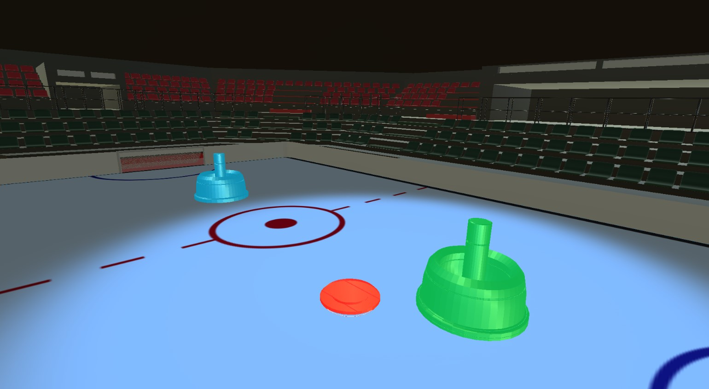
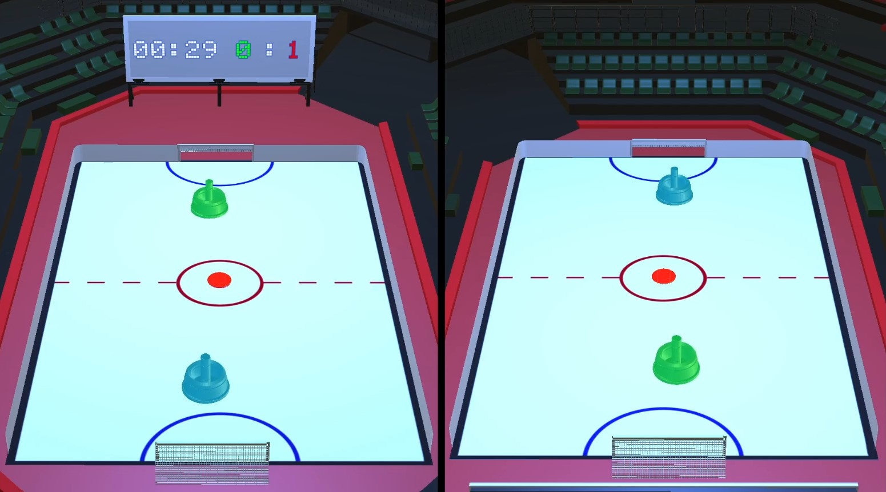
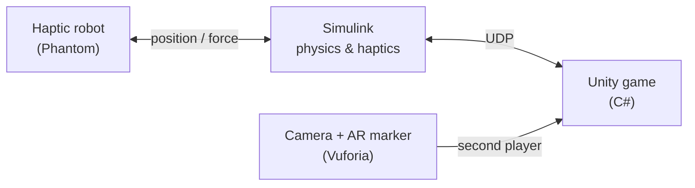
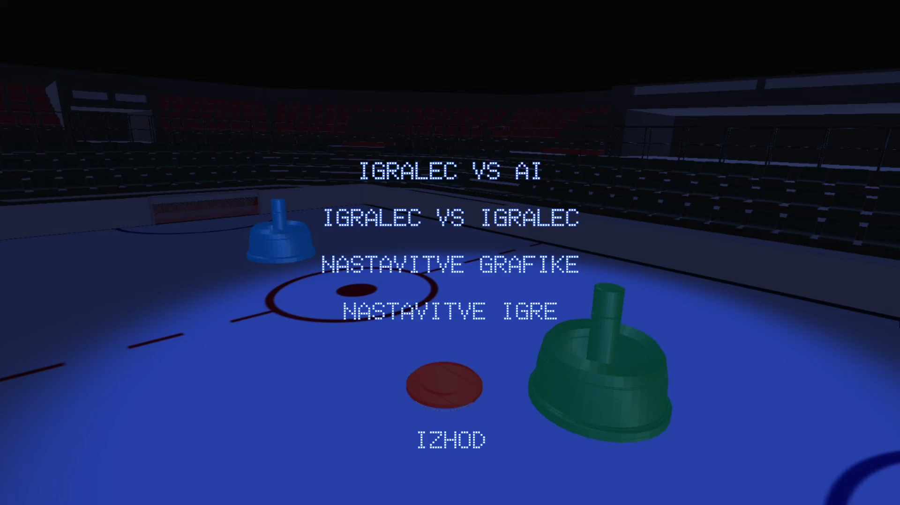
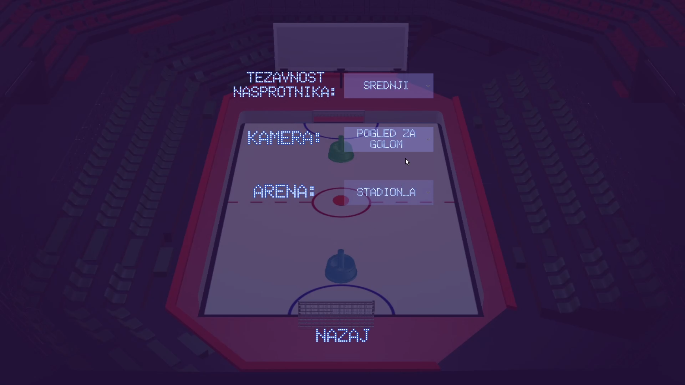

# Haptic Air Hockey with Augmented Reality

An air hockey game where you play with a real haptic robot: you move the robot arm to control your mallet in a Unity game, and the robot pushes back so you feel every hit of the puck and every collision with the wall. A second player can join through augmented reality by moving a 3D-printed marker in front of a camera.

https://github.com/user-attachments/assets/VIDEO-ID

  
  

## How it works

**Simulink.** Reads the position of the robot arm, simulates the puck physics (collisions with walls, mallets and goals) and computes the force the robot applies to the player's hand. Positions are sent to Unity over UDP.

**Unity game (C#).** Renders the game and handles everything around it:
- **Robot input:** maps the robot and puck positions from Simulink into the 3D scene in real time.
- **AI opponent** with three difficulty levels. It switches between defence (stays in front of its goal and follows the puck) and attack (moves toward the puck and strikes), with a reaction delay that depends on difficulty. Its position is sent back to Simulink, so the robot also feels the opponent's hits.
- **AR opponent:** in player vs player mode a second player moves a 3D-printed marker. Vuforia tracks it with a webcam and the motion is smoothed with an exponential moving average before it drives the opponent.
- **Game logic:** score, timer, goal detection, puck reset after a goal, win and loss screens.
- **Menus and settings:** main menu, pause menu, two arenas, camera views, graphics quality, resolution and volume, and a split screen for player vs player.
- **Audio:** separate music and sound effects for the menu, hits, goals, winning and losing.

  
  

## Code

The `unity-scripts` folder contains the C# scripts written for this project:

| Script | Purpose |
|---|---|
| `OpponentAI.cs` | AI opponent: defence and attack behaviour, difficulty levels |
| `sledenje_zogici.cs` | AR opponent: marker tracking with motion smoothing |
| `IgralecPremik.cs`, `PakPremik.cs` | Player mallet and puck position from the robot / Simulink |
| `GameManager.cs` | Score, timer, goals, puck reset, end of game |
| `StadionManager.cs` | Arena, camera and game mode (vs AI or vs player) setup |
| `MainMenu.cs`, `PauseMenu.cs`, `SettingsMenu.cs` | Menus, graphics and audio settings |
| `AudioManager.cs` | Music and sound effects |
| `GolIgralec.cs`, `GolNasprotnik.cs`, `OpponentController.cs` | Goal triggers and opponent control |

## Built with

Unity, C#, Vuforia Engine, MATLAB / Simulink, Blender (3D models), Onshape and a 3D printer (AR marker).

## Team

University project for the course *Virtual and Augmented Reality*, Faculty of Electrical Engineering, University of Ljubljana (2025).
